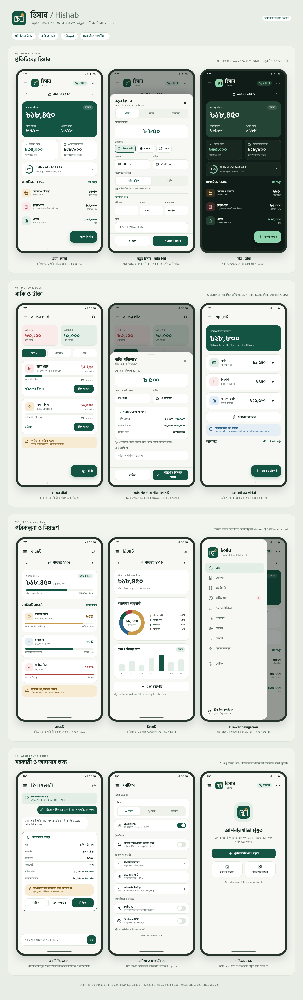

<div align="center">

# হিসাব · Hishab

**আপনার খাতা, আপনার নিয়ন্ত্রণে** — বাংলা-প্রথম, offline-first ব্যক্তিগত হিসাবের অ্যাপ।

[](https://github.com/themuhammad-personal/Hishab/actions/workflows/ci.yml)
[](https://github.com/themuhammad-personal/Hishab/actions/workflows/release.yml)




</div>

---

## বাংলা

### হিসাব কী

হিসাব একটি নেটিভ Android অ্যাপ (`com.hishab.app`) যা দৈনন্দিন আয়-খরচ, বাকি, ওয়ালেট, কেনার তালিকা, বাজেট ও রিপোর্ট এক জায়গায় রাখে। সব আর্থিক তথ্য ডিভাইসেই থাকে; এই সংস্করণে ক্লাউড সিঙ্ক ও ক্লাউড AI বন্ধ। কোনো নমুনা লেনদেন নিজে থেকে যোগ হয় না।

### প্রধান ফিচার

- **দৈনন্দিন হিসাব:** আয়/খরচ/বাকি, search ও filter, তারিখ অনুযায়ী গ্রুপিং, পরিমাণ × একক দাম, নোট, swipe edit/delete ও undo।
- **দ্বৈত হিসাবরক্ষণ:** মাসের খরচ বাকিসহ গণনা হয়; ওয়ালেট কমে শুধু প্রকৃত পরিশোধে; বাকি আলাদাভাবে দেখা যায়।
- **বাকির খাতা:** দেনা ও পাওনা, আংশিক পরিশোধ, পরিশোধের ইতিহাস, স্থানীয় রিমাইন্ডার ও ঐচ্ছিক Calendar shortcut।
- **ওয়ালেট:** নগদ/মোবাইল/ব্যাংক/কাস্টম ওয়ালেট, প্রারম্ভিক ব্যালেন্স, স্থানান্তর, আর্কাইভ ও স্থানান্তর ইতিহাস।
- **ক্যাটাগরি:** আয়/খরচ ক্যাটাগরি, ৬০+ আইকন, রং, আর্কাইভ, item-wise insight।
- **কেনার তালিকা:** পরিমাণ/একক/আনুমানিক দাম, অগ্রাধিকার, idempotent expense conversion।
- **বাজেট:** মাসিক ও ক্যাটাগরি বাজেট; ৮০% ও ১০০%-এ in-app সতর্কতা, কিন্তু খরচ ব্লক করে না।
- **রিপোর্ট:** ক্যাটাগরি donut, শেষ ৭ দিনের বার চার্ট, UTF-8 CSV export।
- **ব্যাকআপ:** schema-versioned পূর্ণ JSON backup/restore, preview, merge/replace, কঠোর validation; CSV spreadsheet export।
- **সহকারী:** conservative local parser শুধু draft তৈরি করে; প্রতিটি mutation-এর আগে preview + নিশ্চিতকরণ বাধ্যতামূলক।
- **চেহারা:** warm paper + deep emerald, light/dark/system theme, বাংলা/English digit toggle, Hind Siliguri ফন্ট।

### হিসাবের নীতি

| বিষয় | নিয়ম |
|---|---|
| টাকা | `Long` poisha; binary floating-point নয় |
| মাসের খরচ | লেনদেনের তারিখের মাসে মোট খরচ, বাকিসহ |
| ওয়ালেট ব্যালেন্স | প্রারম্ভিক + পরিশোধিত আয় − পরিশোধিত খরচ ± স্থানান্তর |
| বাকি | মূল পরিমাণ − পরিশোধের ইতিহাসের যোগফল |
| স্থানান্তর | আয় বা খরচ নয়; মোট ব্যালেন্স অপরিবর্তিত |
| বাজেট | মাসের মোট খরচের ভিত্তিতে, বাকিসহ |
| মুছে ফেলা | লেনদেন soft-delete + undo; reset আলাদা confirm |

### গোপনীয়তা

- `INTERNET` permission নেই; অ্যাপটি সম্পূর্ণ অফলাইনে চলে।
- Firebase, analytics, ads বা credential SDK নেই।
- Cloud AI ও sync UI-তে নিষ্ক্রিয়; ভবিষ্যতে চালু হলে আলাদা consent লাগবে।
- Android cloud backup/device-transfer নিষ্ক্রিয়; backup/restore শুধু আপনার বেছে নেওয়া ফাইলে (SAF)।
- Notification permission ঐচ্ছিক; Calendar shortcut-এ calendar permission লাগে না।
- Signing key শুধু GitHub Secrets-এ থাকে; repo বা chat-এ রাখা হয় না।

### বিল্ড ও রান

প্রয়োজন: JDK 17, Android SDK (compile/target 36), Android 10+ ডিভাইস/এমুলেটর।

```bash
./gradlew lintDebug testDebugUnitTest assembleDebug
```

Debug APK: `app/build/outputs/apk/debug/`। Debug applicationId `com.hishab.app.debug`, release `com.hishab.app`।

CI প্রতিটি push/PR-এ wrapper validation, lint, unit/Robolectric tests, debug build এবং unsigned release R8 compile check চালায়। Room v1 schema `app/schemas/`-এ export ও সংরক্ষিত হয়। এই sandbox-এ JDK/Android SDK নেই, তাই compile/test যাচাই GitHub Actions-এ হয়েছে।

### Signed release

Release workflow `v*` tag-এ চলে এবং secret না থাকলে fail-fast করে। প্রথমে নিজের ডিভাইসে offline keystore তৈরি করুন:

```bash
keytool -genkeypair -v -keystore hishab-release.jks -alias hishab \
  -keyalg RSA -keysize 4096 -validity 10000
base64 -w 0 hishab-release.jks > hishab-release.jks.base64
```

GitHub repo → Settings → Secrets and variables → Actions-এ যোগ করুন:

- `HISHAB_KEYSTORE_BASE64`
- `HISHAB_KEYSTORE_PASSWORD`
- `HISHAB_KEY_ALIAS`
- `HISHAB_KEY_PASSWORD`

তারপর:

```bash
git tag v1.0.0
git push origin v1.0.0
```

Workflow lint/test/release build → `apksigner verify` → SHA-256 → GitHub Release-এ signed APK + checksum প্রকাশ করে। Keystore ও password কখনো commit/chat/share করবেন না; নিরাপদ offline backup রাখুন।

### ট্রাবলশুটিং

- **SDK পাওয়া যাচ্ছে না:** `local.properties`-এ `sdk.dir` দিন বা Android Studio দিয়ে SDK install করুন।
- **Wrapper checksum mismatch:** `gradle/wrapper/gradle-wrapper.properties`-এর `distributionSha256Sum` Gradle 8.11.1-এর সরকারি checksum-এর সাথে মিলছে কিনা দেখুন।
- **Release unsigned/ব্যর্থ:** চারটি signing secret আছে কিনা এবং base64 keystore সঠিক কিনা যাচাই করুন।
- **রিমাইন্ডার আসছে না:** Settings → রিমাইন্ডার চালু করুন এবং Android notification permission দিন।
- **Backup merge ব্যর্থ:** একই id-এর conflicting/partial ডেটা থাকলে resulting ledger validation আগে ব্যর্থ হয়; পূর্ণ backup দিয়ে replace করুন।

### রোডম্যাপ

v1-এ ইচ্ছাকৃতভাবে নেই: PIN/biometric lock, Google Drive appDataFolder backup, সক্রিয় Firebase sync, cloud AI, PDF export। Firebase/console যাচাই ও আলাদা consent-এর পরে এগুলো বিবেচনা করা হবে।

---

## English

Hishab is a Bengali-first, local-first personal ledger for Android. It tracks income, expenses, dues, wallets, shopping lists, budgets and reports without ads, analytics or required cloud services. Money is stored as integer poisha; monthly expenses include unpaid amounts, while wallet balances move only on actual payments. Transfers are balance-neutral.

**Build:** JDK 17 + Android SDK 36, then `./gradlew lintDebug testDebugUnitTest assembleDebug`.  
**Release:** add the four `HISHAB_*` signing secrets, push a `v*` tag; CI verifies the signature and publishes an APK + SHA-256.  
**Privacy:** no `INTERNET` permission, no Firebase/analytics/ads SDKs, user-controlled SAF backup/restore.  
**AI:** offline parser returns drafts only; every write requires explicit preview + confirmation.

### Documentation & attribution

- Design spec: [`docs/design/DESIGN_SPEC.md`](docs/design/DESIGN_SPEC.md)
- Approved implementation plan: [`docs/design/FINAL_PLAN.md`](docs/design/FINAL_PLAN.md)
- Legacy code audit: [`docs/review/CODE_AUDIT.md`](docs/review/CODE_AUDIT.md)
- Font: Hind Siliguri, SIL Open Font License — [`app/src/main/assets/licenses/HindSiliguri-OFL.txt`](app/src/main/assets/licenses/HindSiliguri-OFL.txt)
- Mockup figures are illustrative only; the app ships with no seeded transactions.

Application code license has not yet been specified by the repository owner.
